<p align="center">
  
</p>

<h1 align="center">FinanZillo</h1>

<p align="center">
  <b>Tus gastos, ingresos y patrimonio en el PC. En un único archivo cifrado, sin nube ni cuentas.</b><br>
  App de escritorio nativa para Windows, escrita en Rust. En español y en euros.
</p>

<p align="center">
  <a href="https://github.com/adrmoralf/FinanZillo/releases/latest"><b>⬇ Descargar para Windows</b></a>
</p>

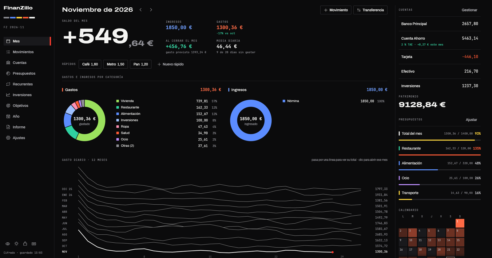

> Las capturas usan **datos ficticios** generados con `finanzillo --demo`. Ningún dato es real.

## Qué es

FinanZillo es una app de finanzas personales hecha para usarse a diario: apuntas un gasto en segundos con el teclado y ves de un vistazo cómo va el mes, en qué se va el dinero y cuánto patrimonio tienes. Todo se guarda en tu PC, en **un único archivo cifrado con tu contraseña**. No hay servidor, ni registro, ni sincronización con nadie.

- **Apuntar en segundos**: `Ctrl+N` abre el movimiento con el importe en grande; escribes el concepto (si ya lo usaste, propone categoría y cuenta), eliges la categoría con un clic o tecleando sus primeras letras y `Ctrl+Enter`. Con «Deshacer» por si acaso. El importe admite cuentas: `12,50+3*2`.
- **El mes de un vistazo**: saldo del mes, proyección al cierre, media diaria, días sin gastar, **anillos de gastos e ingresos por categoría** (pasa el ratón para resaltar, clic para ver la categoría) y el **pulso**: el gasto diario de los últimos 12 meses dibujado como líneas apiladas (clic en una línea para ir a ese mes).
- **Cuentas que cuadran con el banco**: saldo inicial por cuenta, transferencias, ajuste para cuadrar con el saldo real y **cuentas remuneradas con TAE**: el interés se calcula a diario y el último día de cada mes se apunta como ingreso (editable si el banco pagó otra cifra).
- **Presupuestos** por categoría y total, con historial por mes y el **ritmo de gasto** frente al mes anterior.
- **Recurrentes**: nómina, alquiler, suscripciones, traspasos y aportaciones a inversiones se apuntan solos cada mes. Detecta pagos repetidos que parecen suscripciones.
- **Inversiones** con precio en vivo (Yahoo Finance o CoinGecko) o manual, compras y ventas con coste medio y ganancia realizada.
- **Objetivos de ahorro** con fecha límite y cuota mensual sugerida.
- **Vista anual** e **informe mensual** con conclusiones automáticas, exportable a **PDF**, HTML y Markdown.
- **Gastos rápidos** de un clic, etiquetas, filtros y búsqueda, importación y exportación **CSV**, modo privacidad (`Ctrl+H`) y tema claro u oscuro.

## Capturas

| | |
|---|---|
| 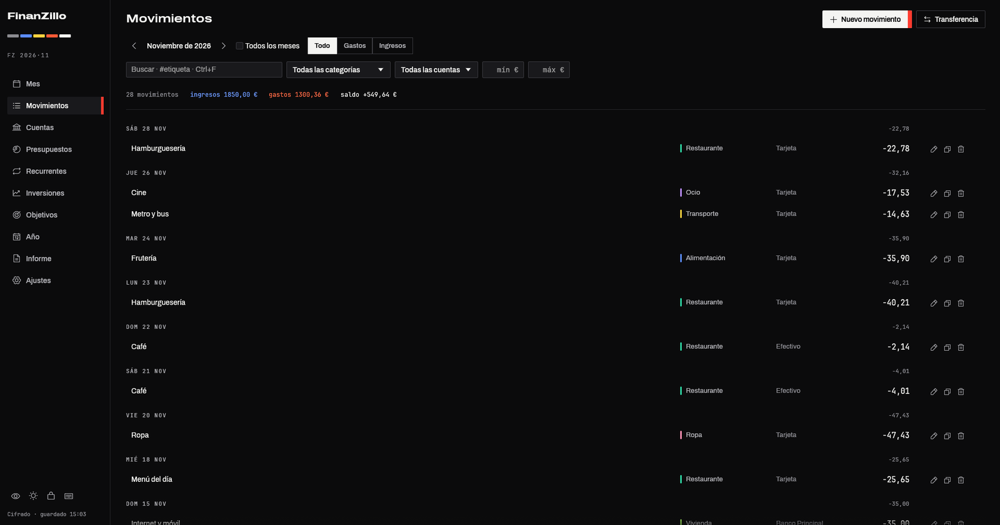 | 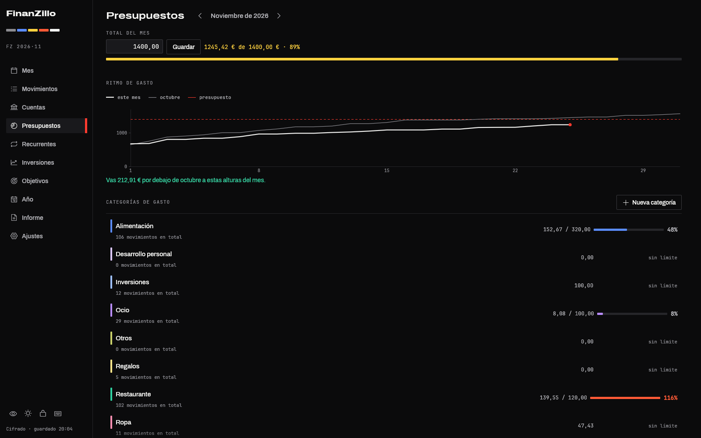 |
| **Movimientos**: filtros por mes, tipo, categoría, cuenta, importe y texto o `#etiqueta`. | **Presupuestos**: ritmo de gasto del mes frente al anterior y la línea del presupuesto. |
| 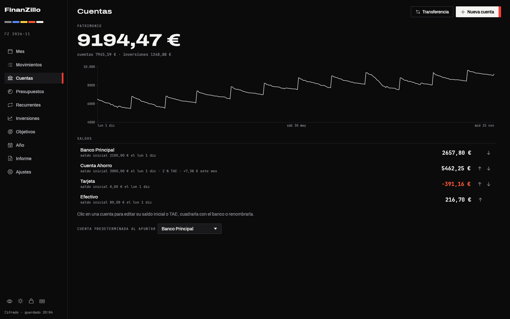 | 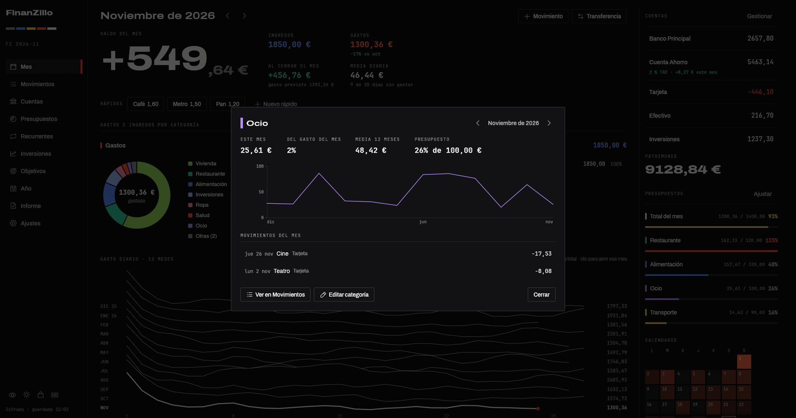 |
| **Cuentas**: patrimonio, evolución diaria y saldos con su TAE. | **Ficha de categoría**: 12 meses, media, presupuesto y sus movimientos. |
| 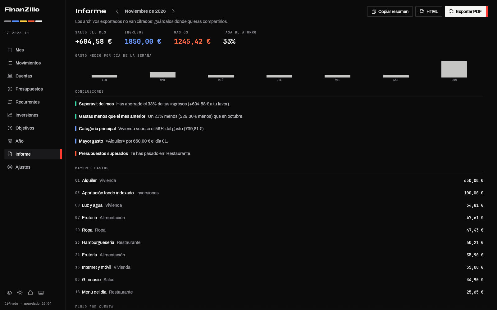 | 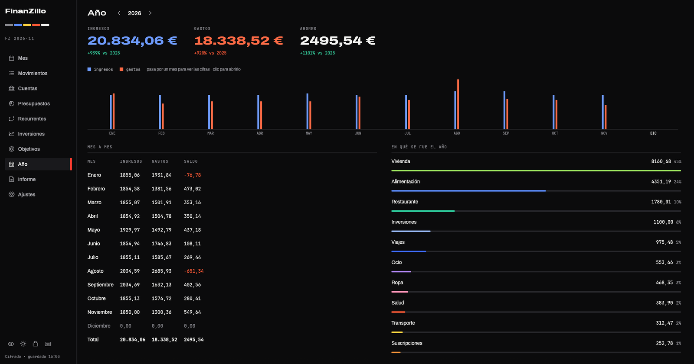 |
| **Informe** del mes con conclusiones, exportable a PDF. | **Año**: mes a mes y en qué se fue el dinero. |
| 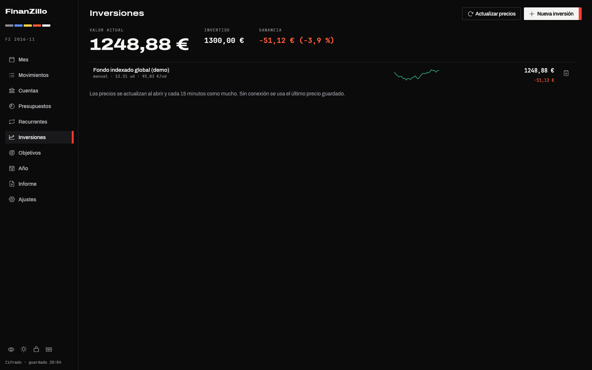 | 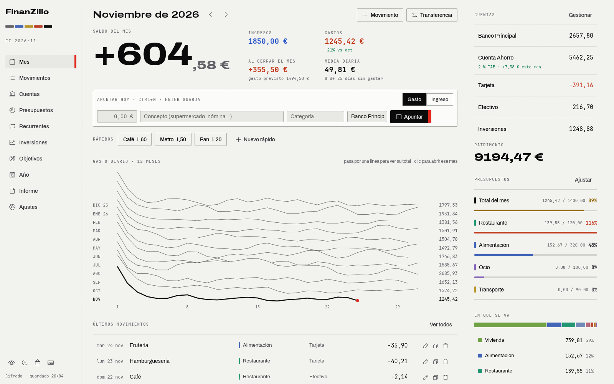 |
| **Inversiones** con su línea de 30 días. | **Tema claro**. |
| 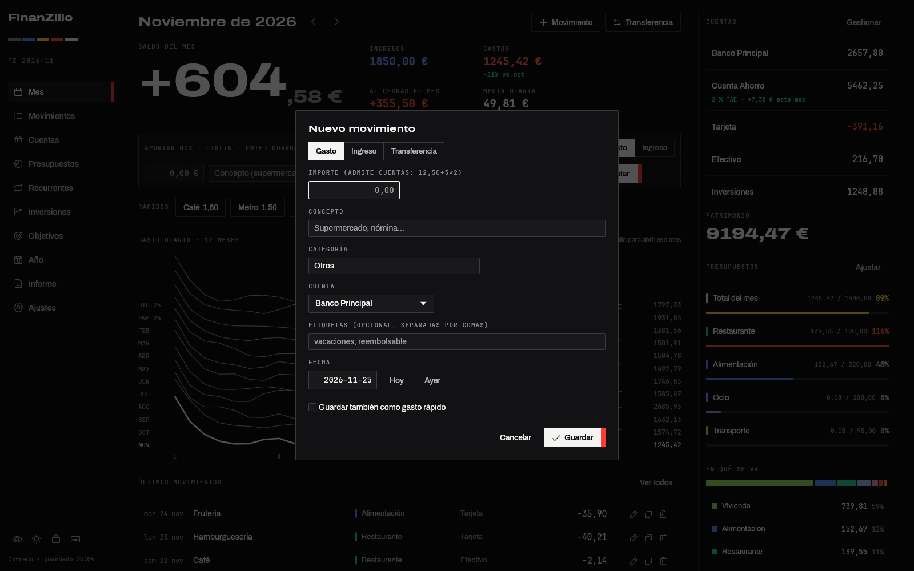 | 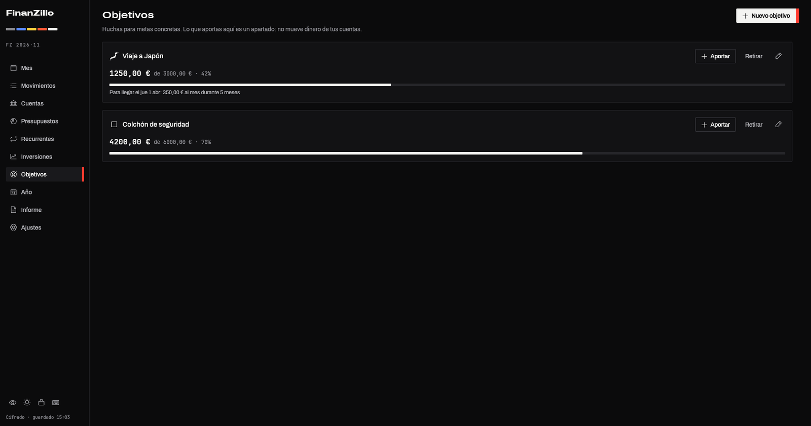 |
| **Nuevo movimiento** (`Ctrl+N`): importe grande, categorías con su color. | **Objetivos** de ahorro con su cuota mensual. |

<p align="center">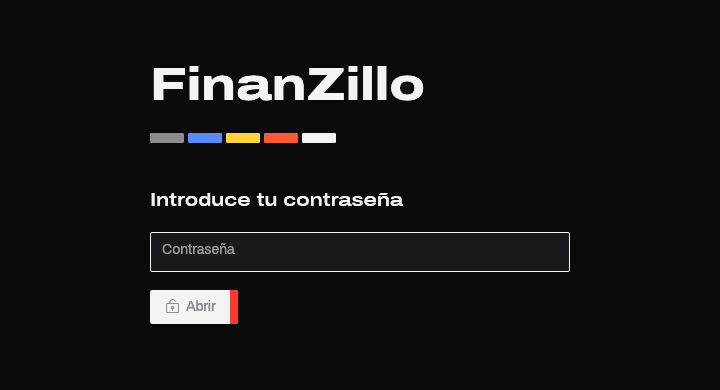</p>

## Privacidad y seguridad

- **Un único archivo cifrado**: `%APPDATA%\FinanZillo\finanzillo.fzl`. La base de datos (SQLite) vive en memoria; al guardar se cifra entera con **XChaCha20-Poly1305** y una clave derivada de tu contraseña con **Argon2id** (64 MiB, 3 pasadas). En disco nunca hay una copia sin cifrar. Cualquier manipulación del archivo se detecta.
- **Sin la contraseña no hay recuperación.** Guárdala en un gestor de contraseñas.
- Se guarda solo (y de forma atómica) y cada día hace una **copia cifrada** en `%APPDATA%\FinanZillo\copias` (las 30 últimas). Puedes añadir una carpeta externa, por ejemplo de OneDrive: las copias siguen cifradas.
- Se bloquea con `Ctrl+L` y tras 15 minutos sin uso (configurable).
- **Entrar con el PIN de Windows** (opcional, en Ajustes): Windows Hello (PIN, huella o cara) firma con una clave guardada en el chip de seguridad del equipo y de esa firma sale la clave que abre el archivo. El PIN no se guarda en ningún sitio y la contraseña sigue valiendo siempre.
- La única conexión a internet es para los **precios de inversiones** que tú añadas (Yahoo Finance o CoinGecko). Sin inversiones con precio en vivo, la app no sale a la red.
- Lo que **exportas** (CSV, HTML, PDF) no va cifrado: guárdalo donde corresponda.

## Instalar

1. Descarga `FinanZillo-X.Y.Z-instalador.exe` de la [última release](https://github.com/adrmoralf/FinanZillo/releases/latest) y, si quieres, comprueba su suma con `SHA256SUMS.txt`.
2. Ejecútalo. Se instala **solo para tu usuario**, sin permisos de administrador. Como el instalador no está firmado, Windows puede avisar con SmartScreen: «Más información» → «Ejecutar de todas formas».
3. Al abrir FinanZillo por primera vez, crea tu contraseña: se crea un archivo de datos nuevo y vacío, con unas categorías de partida. Puedes importar un CSV de tu banco (Ajustes) o una base de FinanZillo que ya tuvieras.

Desinstalar no borra tus datos. Requisitos: Windows 10 u 11 de 64 bits.

### Probar con datos de ejemplo

```powershell
& "$env:LOCALAPPDATA\Programs\FinanZillo\finanzillo.exe" --demo "$env:TEMP\finanzillo-demo.db"
```

Después, en la pantalla de creación, pulsa «Importar una base de datos…» y elige ese archivo. Son los mismos datos ficticios de las capturas.

## Atajos de teclado

| Atajo | Acción |
|---|---|
| `Ctrl+N` · `Ctrl+Enter` | Nuevo movimiento · guardarlo |
| `Ctrl+T` | Transferencia entre cuentas |
| `Ctrl+F` | Buscar movimientos |
| `Alt+←` / `Alt+→` | Mes anterior / siguiente |
| `Ctrl+1` … `Ctrl+0` | Ir a cada sección |
| `Ctrl+H` · `Ctrl+L` · `Ctrl+S` | Ocultar importes · bloquear · guardar ya |
| `Esc` · `F1` | Cerrar diálogo · ayuda |

## Compilar desde el código

Necesitas [Rust](https://rustup.rs) (toolchain MSVC) y, para el instalador, [Inno Setup 6](https://jrsoftware.org/isinfo.php).

```bash
cd desktop
cargo test                 # pruebas: cifrado, cálculos, recurrentes, intereses, CSV, informe…
cargo run                  # versión de desarrollo
cargo build --release      # target/release/finanzillo.exe
"%ProgramFiles(x86)%\Inno Setup 6\ISCC.exe" installer\finanzillo.iss   # → target/instalador/
```

Las releases se generan solas: al subir una etiqueta `vX.Y.Z`, GitHub Actions prueba, compila, crea el instalador y publica la release ([`.github/workflows/release.yml`](.github/workflows/release.yml)).

Estructura de `desktop/src`:

| Módulo | Qué hace |
|---|---|
| `store.rs` | Cifrado y formato del archivo, escritura atómica, copias |
| `db.rs` | Esquema SQLite, migraciones, memoria ↔ bytes, importación |
| `ledger/` | Lógica: movimientos, cuentas e intereses, recurrentes, análisis, inversiones, CSV, informe |
| `ui/` | Interfaz con [egui](https://github.com/emilk/egui): tema, componentes, gráficas, vistas y diálogos |
| `hello.rs` | Desbloqueo con el PIN de Windows (Windows Hello) |
| `demo.rs` | Datos de demostración ficticios |

## Diseño

El sistema visual («Catálogo Factory»: negro mate, cifras grandes, filetes de un píxel y color solo con función) está documentado en [DESIGN.md](DESIGN.md). Tipografías [Archivo](https://github.com/Omnibus-Type/Archivo) y [JetBrains Mono](https://github.com/JetBrains/JetBrainsMono) (licencia OFL, incluidas en `desktop/assets/fonts`) e iconos [Phosphor](https://phosphoricons.com) (MIT).

## Licencia

[MIT](LICENSE).
